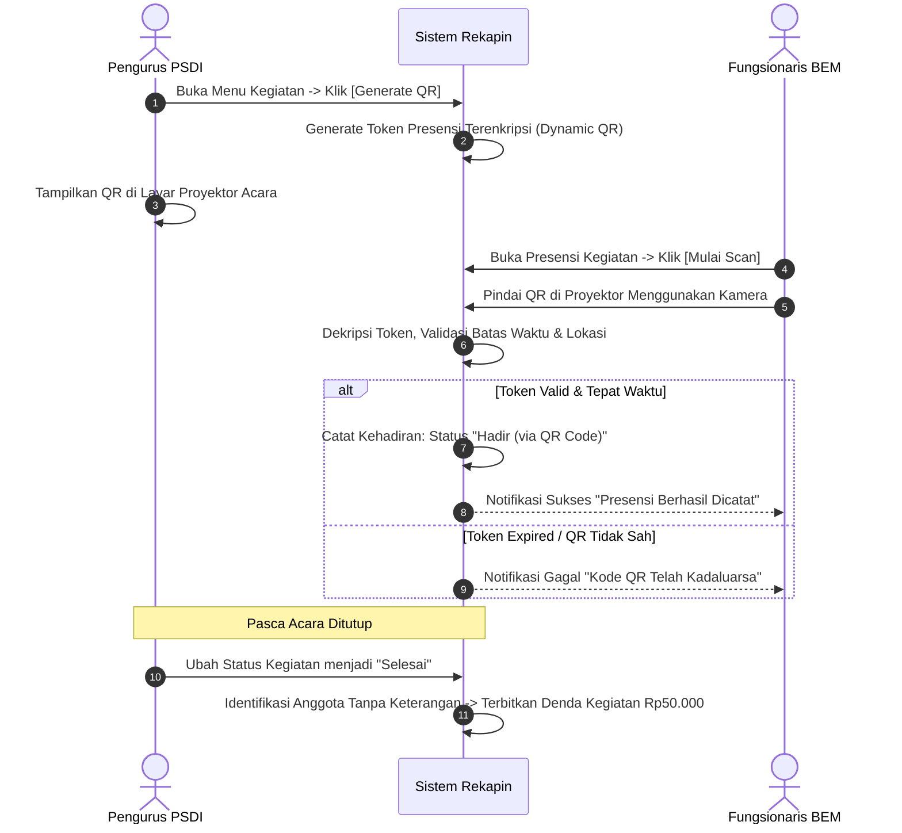

# Modul 06: Manajemen Kegiatan & Presensi Berbasis QR Code

## 1. Deskripsi Fitur
Modul Manajemen Kegiatan dan Presensi QR Code dikelola oleh Departemen **PSDI (Pengembangan Sumber Daya Internal)** untuk mengoordinasikan seluruh agenda acara internal BEM FILKOM UB (seperti seminar, pelatihan, workshop, rapat kerja, dan *focus group discussion*). Modul ini menyediakan sistem presensi nirsentuh yang cepat dan akurat menggunakan **QR Code Dinamis** yang dihasilkan oleh panitia acara serta dipindai (*scan*) oleh kamera perangkat fungsionaris secara *real-time*.

---

## 2. Acuan Tangkapan Layar (Screenshots)
- **Katalog & Manajemen Kegiatan (PSDI)**:
  - [`Rekapin-Resource/UI-PSDI/kegiatan semua.png`](file:///c:/Users/Archie/Downloads/MPTI-Kelompok1/Rekapin-Resource/UI-PSDI/kegiatan%20semua.png)
  - [`Rekapin-Resource/UI-PSDI/kegiatan berlangsung.png`](file:///c:/Users/Archie/Downloads/MPTI-Kelompok1/Rekapin-Resource/UI-PSDI/kegiatan%20berlangsung.png)
  - [`Rekapin-Resource/UI-PSDI/kegiatan akan datang.png`](file:///c:/Users/Archie/Downloads/MPTI-Kelompok1/Rekapin-Resource/UI-PSDI/kegiatan%20akan%20datang.png)
  - [`Rekapin-Resource/UI-PSDI/kegiatan selesai.png`](file:///c:/Users/Archie/Downloads/MPTI-Kelompok1/Rekapin-Resource/UI-PSDI/kegiatan%20selesai.png)
- **Pemindai Kamera QR Presensi (Anggota & PresBEM)**:
  - [`Rekapin-Resource/UI-Anggota/scan qr anggota.png`](file:///c:/Users/Archie/Downloads/MPTI-Kelompok1/Rekapin-Resource/UI-Anggota/scan%20qr%20anggota.png)
  - [`Rekapin-Resource/UI-PresBem/qr presensi.png`](file:///c:/Users/Archie/Downloads/MPTI-Kelompok1/Rekapin-Resource/UI-PresBem/qr%20presensi.png)
- **Riwayat Presensi Kegiatan (Anggota & PresBEM)**:
  - [`Rekapin-Resource/UI-Anggota/riwayat presensi anggota-1.png`](file:///c:/Users/Archie/Downloads/MPTI-Kelompok1/Rekapin-Resource/UI-Anggota/riwayat%20presensi%20anggota-1.png)
  - [`Rekapin-Resource/UI-PresBem/riwayat scan.png`](file:///c:/Users/Archie/Downloads/MPTI-Kelompok1/Rekapin-Resource/UI-PresBem/riwayat%20scan.png)

---

## 3. Komponen & Spesifikasi Antarmuka (UI Specification)

### 3.1. Halaman Manajemen Kegiatan (PSDI)
Digunakan oleh pengurus PSDI untuk mempublikasikan dan mengelola acara:
1. **Header & Tombol Tambah**:
   - Judul: *"Kegiatan - Manajemen kegiatan dan generate QR presensi"*.
   - Tombol Aksi: `[+ Tambah Kegiatan]` (membuka modal formulir pembuatan kegiatan baru).
2. **Filter Status Pelaksanaan**:
   - Tab tombol navigasi: `Semua` | `Akan Datang` | `Berlangsung` | `Selesai`.
3. **Kartu Grid Kegiatan (*Event Cards Grid*)**:
   - Setiap kartu kegiatan menyajikan:
     - **Judul Kegiatan**: e.g. *Seminar Kepemimpinan*, *Workshop UI/UX Design*, *Pelatihan Public Speaking*, *FGD Roadmap BEM 2026*.
     - **Badge Status**:
       - `Selesai`: Berlatar hijau muda.
       - `Akan Datang`: Berlatar biru muda.
       - `Berlangsung`: Berlatar oranye/merah aktif.
     - **Deskripsi Ringkas Acara**: Penjelasan tujuan dan sasaran peserta.
     - **Metadata Pelaksanaan**:
       - 📅 Tanggal pelaksanaan (e.g. `20/09/2025`, `28/09/2025`).
       - 📍 Lokasi acara (e.g. `Aula FILKOM`, `Lab Komputer 301`, `Ruang Rapat BEM`).
       - 👥 Statistik Peserta: e.g. `28/30 hadir` (jika selesai) atau `20 peserta terdaftar` (jika mendatang).
     - **Tombol Aksi**:
       - `[Detail]`: Membuka daftar hadir lengkap dan catatan kegiatan.
       - `[Generate QR]`: Muncul pada status *Akan Datang* untuk membuat kode QR baru.
       - `[Lihat QR]`: Muncul pada status *Selesai* / *Berlangsung* untuk memproyeksikan QR di proyektor.

---

### 3.2. Halaman Presensi Kegiatan (Scan QR - Anggota & PresBEM)
Digunakan oleh fungsionaris saat hadir di lokasi kegiatan:
1. **Sistem Tab Navigasi**:
   - Tab aktif: `Scan QR` | Tab sekunder: `Riwayat Presensi`.
2. **Frame Pemindai Kamera (*Camera Viewfinder Frame*)**:
   - Judul: *"Scan QR Presensi"*.
   - Subjudul instruksi: *"Minta panitia untuk menampilkan QR code kegiatan"*.
   - Kotak Viewfinder Kamera: Dilengkapi sudut bidik (*corner brackets*) dan ikon pemindaian interaktif (*"Arahkan kamera ke QR Code"*).
   - Tombol Aksi: `[Mulai Scan]` (mengaktifkan modul kamera perangkat/webcam).
3. **Banner Informasi Lokasi**:
   - Pesan informasi: *"Pastikan Anda berada di lokasi kegiatan saat melakukan presensi"*.

---

### 3.3. Tab Riwayat Presensi Kegiatan
Menampilkan catatan partisipasi kegiatan fungsionaris:
1. **Daftar Log Presensi Acara**:
   - Setiap entri mencakup:
     - Ikon status (centang hijau dalam lingkaran atau silang merah).
     - **Nama Acara**: e.g. *Seminar Kepemimpinan*, *Workshop UI/UX Design*, *Rapat Koordinasi Bulanan*.
     - **Tanggal & Metode Presensi**: e.g. `20/09/2025 · via QR Code`, `10/09/2025 · via Manual`.
     - **Status Badge**:
       - `Hadir`: Berlatar hijau muda.
       - `Tidak Hadir`: Berlatar merah muda.

---

## 4. Alur Kerja Presensi QR Dinamis (Workflow)

---

## 5. Aturan Bisnis & Mekanisme Keamanan
1. **Dynamic Rolling QR**: Untuk mencegah kecurangan fungsionaris menitip presensi lewat tangkapan layar (*screenshot sharing*), token QR diperbarui (*refresh*) setiap 30–60 detik.
2. **One-Time Scan Constraint**: Satu akun fungsionaris hanya dapat melakukan presensi satu kali per kegiatan.
3. **Penyusulan Manual (Dispensasi)**: Panitia PSDI memiliki kewenangan menandai presensi secara `Manual` bila fungsionaris mengalami kendala teknis pada kamera perangkatnya.
4. **Sanksi Ketidakhadiran (Alpha Kegiatan)**: Fungsionaris yang wajib hadir namun tidak melakukan presensi sampai status acara `Selesai` otomatis dikenakan sanksi **Denda Kegiatan sebesar Rp50.000**.
